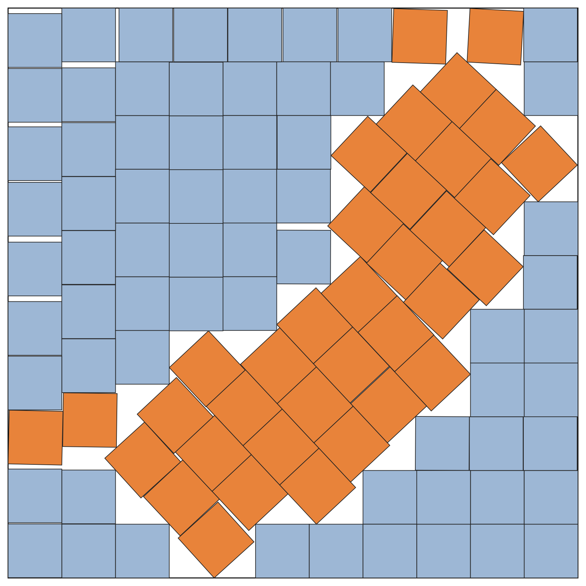

# 102 unit squares in a square: s = 10.605828696455852



102 non-overlapping unit squares in a square of side **s = 10.605828696455852**: a certified upper bound
5.5 × 10⁻¹¹ below the registered best known 10.6058286965106059 (ry-xu, jlevy/squares register T-125).

## Priority

ry-xu published a packing with this width first (github.com/ry-xu/square_packing, commit 8dc4152, 2026-10-08 00:03 UTC).
My search found its packing independently about 10 hours later (10:25 UTC), without reading any published layout.
The two share the same overall design (the same grid blocks and the same 43° diagonal band) and the same width to
within 8 × 10⁻¹¹, but they are different arrangements: aligned (ry-xu's rotated 180°), 40 of the 102 squares coincide
exactly, 39 differ by less than 0.05 of a square, and 23 differ by more, 7 of them by up to half a square. ry-xu has
priority for this design and width; this repository holds a different arrangement reaching the same optimum, and a
tighter certified bound on it.

## How the bound was made

Solved to the bottom of its valley (sequential LP over the active contacts), the packing reaches
s = 10.605828696431638. Every centre is then scaled by (1 + 2 × 10⁻¹²) and lifted 2 × 10⁻¹² off the low walls,
and the box is set 2 × 10⁻¹² beyond the highest corner. Since centres are at least 1 apart, every gap is at least
about 2 × 10⁻¹².

## Files

| file | contents |
|---|---|
| `n102_s10.605828696455852.txt` | one square per line: centre `x y` and rotation `theta` (radians), 17 significant digits; header `# s = …` |
| `n102_s10.605828696455852.json` | the same layout as JSON |
| `n102_s10.605828696455852_submission.svg` | exact SVG in the packing's own units (box 0..s, y up), each square's centre and angle as `data-x` / `data-y` / `data-theta` |
| `n102_s10.605828696455852.png` | the picture (orange squares are tilted) |
| `verify_exact.py` | an independent legality check (plain Python, no dependencies) |

## Verification

```bash
python3 verify_exact.py n102_s10.605828696455852.txt
```

```
n = 102, L = 10.605828696455852: min wall clearance 2.002e-12, min pair gap 1.932e-12 over 931 close pairs → LEGAL
```

The checker converts every value to an exact decimal, computes corners at 60-digit precision and runs a
separating-axis test on every nearby pair and against the walls. The layout also passes the search engine's own
exact rational-interval certificate. As a control, the same layout in a box 10⁻¹¹ smaller fails both.

## How it was found

By my own search engine, from scratch: simulated annealing on the GPU (Apple Metal, 4,096 chains in parallel),
an exact LP finish, and a beam search of structural edits. Built with AI assistance (Claude).

## History

- 8 Oct 2026, 06:25 EDT (10:25 UTC): the search finishes a packing at s = 10.605829491, below the then-published
  best (10.607174680, Couzo, 26 Sep). The refinement search takes it to 10.605828708 the same morning.
- 8 Oct, 17:34 UTC: first reported in Davidebyzero/packing_squares_in_squares__tools#6.
- Later found: ry-xu had published a packing of the same design and width at 00:03 UTC that day.
- 11 Oct: solved to the bottom of its valley and certified with 2 × 10⁻¹² margins at s = 10.605828696455852.

The original 10.605828708 files (wider safety margins) are kept in `earlier/`.
